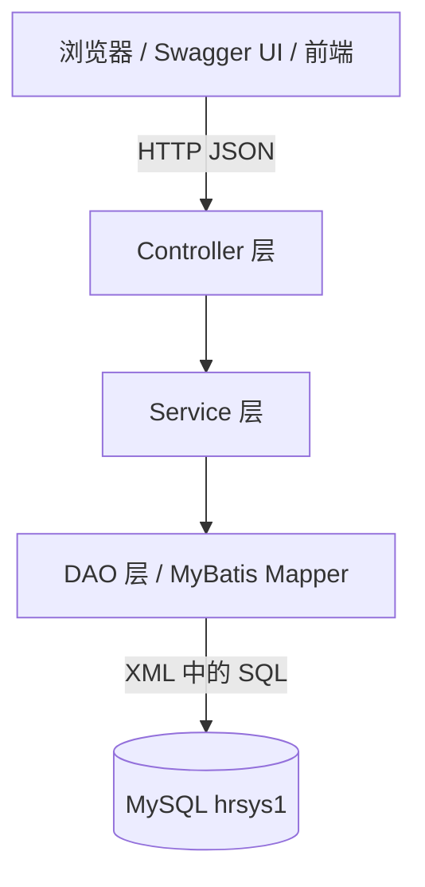

# 人事管理系统 hrproject2

> 一个基于 **Spring Boot 3 + MyBatis + MySQL** 的人力资源管理后端练手项目，实现员工与部门的完整增删改查，并集成 Swagger 在线接口文档。


---

## 目录

- [项目简介](#项目简介)
- [功能特性](#功能特性)
- [技术栈](#技术栈)
- [项目结构](#项目结构)
- [快速开始](#快速开始)
- [接口文档](#接口文档)
- [数据模型](#数据模型)
- [分层架构](#分层架构)
- [单元测试](#单元测试)
- [已知问题与 TODO](#已知问题与-todo)
- [许可证](#许可证)

---

## 项目简介

本项目是《云计算应用开发》课程实训项目，用来练习 Spring Boot 三层架构与 MyBatis 持久层开发。

业务上分为两个模块：

| 模块 | 说明 |
| --- | --- |
| **部门管理** | 部门的增删改查，部门表与员工表通过 `dep_id` 关联 |
| **员工管理** | 员工增删改查，支持按姓名模糊、性别、年龄、部门多条件组合查询 |

---

## 功能特性

- **员工管理**：新增、删除、修改、根据 ID 查询、多条件组合查询
- **部门管理**：新增、删除、修改、查询全部、根据 ID 查询
- **动态 SQL**：`<if>` 标签实现按需拼接查询条件（姓名模糊匹配 + 精确匹配组合）
- **MyBatis XML 映射**：`resultMap` 结果映射 + 下划线转驼峰自动映射
- **Swagger 在线文档**：基于 springdoc-openapi，启动后可直接在浏览器调试接口
- **统一日志**：控制台 + 文件双输出（`logs/hrsys_lzj49.log`）
- **跨域支持**：Controller 上的 `@CrossOrigin`，方便前端（Vue）直接联调
- **单元测试**：DAO 层与 Service 层测试用例

---

## 技术栈

| 分类 | 技术 | 版本 |
| --- | --- | --- |
| 语言 | Java | 17 |
| 框架 | Spring Boot | 3.5.5 |
| Web | Spring MVC（spring-boot-starter-web） | 随 Spring Boot |
| 持久层 | MyBatis（mybatis-spring-boot-starter） | 3.0.5 |
| 数据库 | MySQL | 8.x |
| 驱动 | mysql-connector-j | 随 Spring Boot |
| 接口文档 | springdoc-openapi-starter-webmvc-ui | 2.6.0 |
| 构建工具 | Maven（含 Maven Wrapper） | 3.6+ |
| 热部署 | spring-boot-devtools | 随 Spring Boot |

---

## 项目结构

```
hrproject2/
├── pom.xml                        # 主工程（Spring Initializr 骨架）
├── mvnw / mvnw.cmd                # Maven Wrapper
└── hrsys_lzj49/                   # ★ 业务子工程（实际运行的模块）
    ├── pom.xml
    └── src/
        ├── main/
        │   ├── java/org/lzj/hrsys_lzj49/
        │   │   ├── HrsysLzj49Application.java     # 启动类（@MapperScan 扫描 DAO）
        │   │   ├── config/SwaggerConfig.java      # Swagger 文档配置
        │   │   ├── controller/                    # 员工、部门 Controller
        │   │   ├── service/                       # Service 接口 + impl 实现
        │   │   ├── dao/                           # MyBatis Mapper 接口
        │   │   └── entity/                        # Employee、Department 实体
        │   └── resources/
        │       ├── application.properties         # 数据源 / MyBatis / 日志配置
        │       ├── mapper/                        # MyBatis XML 映射文件
        │       └── sql/employee_table.sql         # 建表脚本（早期版本，见下文说明）
        └── test/java/...                          # DAO 与 Service 单元测试
```

> ⚠️ 注意：根目录 `pom.xml` 只是初始化生成的骨架，**真正的业务代码与依赖都在 `hrsys_lzj49` 子工程里**，启动和运行请进入该目录。

---

## 快速开始

### 1. 环境要求

- JDK 17+
- MySQL 8.0+
- 不需要单独安装 Maven（项目自带 `mvnw`），已安装亦可

### 2. 初始化数据库

登录 MySQL 后执行：

```sql
CREATE DATABASE IF NOT EXISTS hrsys1 DEFAULT CHARACTER SET utf8mb4 COLLATE utf8mb4_general_ci;
USE hrsys1;

-- 部门表
CREATE TABLE department (
    id     INT AUTO_INCREMENT PRIMARY KEY COMMENT '部门ID',
    name   VARCHAR(50) NOT NULL COMMENT '部门名称',
    number INT NOT NULL COMMENT '部门编号'
) ENGINE = InnoDB DEFAULT CHARSET = utf8mb4 COMMENT '部门表';

-- 员工表（与实体类 / Mapper 保持一致）
CREATE TABLE employee (
    id     INT AUTO_INCREMENT PRIMARY KEY COMMENT '员工ID',
    number VARCHAR(20) COMMENT '员工编号',
    name   VARCHAR(50) NOT NULL COMMENT '员工姓名',
    gender VARCHAR(10) COMMENT '员工性别',
    age    INT COMMENT '员工年龄',
    dep_id INT COMMENT '所属部门ID',
    CONSTRAINT fk_employee_department FOREIGN KEY (dep_id) REFERENCES department (id)
) ENGINE = InnoDB DEFAULT CHARSET = utf8mb4 COMMENT '员工信息表';

-- 测试数据
INSERT INTO department (name, number) VALUES ('技术部', 1001), ('产品部', 1002), ('人事部', 1003);

INSERT INTO employee (number, name, gender, age, dep_id) VALUES
('E001', '张三', '男', 28, 1),
('E002', '李四', '女', 26, 1),
('E003', '王五', '男', 30, 2),
('E004', '赵六', '女', 24, 3);
```

> 仓库里的 `src/main/resources/sql/employee_table.sql` 是项目早期版本（`employee` 表用的是 `department`/`salary` 等字段），**与当前的 Employee 实体和 Mapper 不匹配**，请以本节的 DDL 为准。

### 3. 修改数据源配置

编辑 `hrsys_lzj49/src/main/resources/application.properties`，改成你自己的数据库账号密码：

```properties
spring.datasource.url=jdbc:mysql://localhost:3306/hrsys1?serverTimezone=Asia/Shanghai&useUnicode=true&characterEncoding=UTF-8
spring.datasource.username=root
spring.datasource.password=你的密码
```

### 4. 启动项目

```bash
cd hrsys_lzj49
./mvnw spring-boot:run        # Windows 用 mvnw.cmd spring-boot:run
```

或直接在 IDE 中运行 `HrsysLzj49Application` 的 `main` 方法。

启动成功后服务默认监听 **`http://localhost:8080`**。

### 5. 打开接口文档

浏览器访问 👉 **http://localhost:8080/swagger-ui/index.html**

所有接口都可以在页面上直接点 "Try it out" 调试，无需手写 curl。

---

## 接口文档

### 员工管理 `/employee`

| 方法 | 路径 | 说明 |
| --- | --- | --- |
| GET | `/employee/search` | 查询员工列表（支持姓名模糊、性别、年龄、部门组合查询） |
| GET | `/employee/{id}` | 根据 ID 查询单个员工 |
| POST | `/employee/add` | 新增员工 |
| PUT | `/employee/update` | 修改员工（请求体必须带 `id`） |
| DELETE | `/employee/delete/{id}` | 根据 ID 删除员工 |

### 部门管理 `/department`

| 方法 | 路径 | 说明 |
| --- | --- | --- |
| GET | `/department/search` | 查询所有部门 |
| GET | `/department/{id}` | 根据 ID 查询部门 |
| POST | `/department/add` | 新增部门 |
| PUT | `/department/update` | 修改部门（请求体必须带 `id`） |
| DELETE | `/department/delete/{id}` | 删除部门 |

> 接口返回的 `新增成功 / 修改成功 / 删除成功` 为纯文本；查询接口返回 JSON。

### 调用示例

**新增部门**

```bash
curl -X POST http://localhost:8080/department/add \
  -H "Content-Type: application/json" \
  -d '{"name":"财务部","number":1004}'
```

**新增员工**（注意：所属部门通过嵌套的 `dep.id` 传入）

```bash
curl -X POST http://localhost:8080/employee/add \
  -H "Content-Type: application/json" \
  -d '{"number":"E005","name":"钱七","gender":"男","age":32,"dep":{"id":1}}'
```

**组合查询**（按姓名模糊 + 部门）

```bash
curl "http://localhost:8080/employee/search?name=张&dep.id=1"
```

**修改员工**

```bash
curl -X PUT http://localhost:8080/employee/update \
  -H "Content-Type: application/json" \
  -d '{"id":1,"number":"E001","name":"张三丰","gender":"男","age":29,"dep":{"id":2}}'
```

---

## 数据模型

### Department（部门）

| 字段 | 类型 | 说明 |
| --- | --- | --- |
| `id` | Integer | 部门 ID，主键 |
| `name` | String | 部门名称 |
| `number` | Integer | 部门编号 |

### Employee（员工）

| 字段 | 类型 | 说明 |
| --- | --- | --- |
| `id` | Integer | 员工 ID，主键 |
| `number` | String | 员工编号 |
| `name` | String | 员工姓名 |
| `gender` | String | 性别 |
| `age` | Integer | 年龄 |
| `depId` | Integer | 所属部门 ID（数据库字段 `dep_id`） |
| `dep` | Department | 关联的部门对象（用于新增/修改时传部门） |

---

## 分层架构



- **Controller**：接收请求、参数绑定、返回结果
- **Service**：业务逻辑，`boolean` 形式返回成功与否
- **DAO**：`@Mapper` 接口 + `resources/mapper/*.xml` 中的 SQL
- **Entity**：与数据库表对应的 POJO

---

## 单元测试

```bash
cd hrsys_lzj49
./mvnw test
```

测试覆盖：

- `EmployeeDaoTest`：员工 DAO 的增删改查（含组合查询）
- `DepartmentDaoTest`：部门 DAO 的增删改查
- `EmployeeServiceTest` / `DepartmentServiceTest`：Service 层逻辑
- 测试使用独立的 `src/test/resources/application-test.properties`，请按需修改其中的数据源

---

## 已知问题与 TODO

- [ ] `sql/employee_table.sql` 是早期版本，字段与当前实体不一致，待更新为本 README 中的 DDL
- [ ] `EmployeeMapper.updateByDep` 的 SQL 为 `SET dep_id = #{depId} WHERE dep_id = #{depId}`，实际不会修改任何数据，属于未完成功能
- [ ] 接口未做统一返回体（`Result<T>`）封装，也未接入参数校验（`@Valid`）与全局异常处理
- [ ] 数据库密码明文写在 `application.properties` 中，生产环境应改用环境变量或配置中心
- [ ] 缺少分页查询与前端页面

---

## 许可证

本项目基于 [MIT License](https://opensource.org/licenses/MIT) 开源，可自由用于学习与参考。

---

## 作者

**刘祖健**（liuzujian）

- GitHub：<https://github.com/liuzujian>
- 邮箱：2845648726@qq.com
